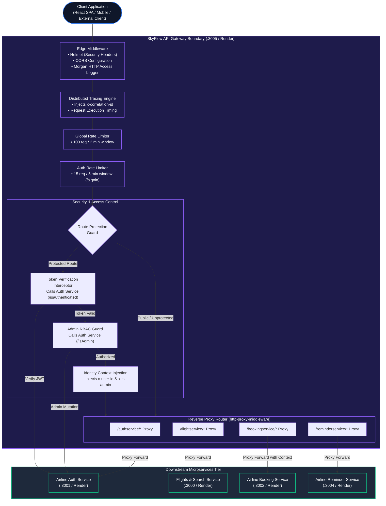

# 🛡️ SkyFlow API Gateway Service

[](https://skyflow-api-gateway-vwri.onrender.com/health)
[](https://nodejs.org/)
[](https://expressjs.com/)
[](https://github.com/chimurai/http-proxy-middleware)
[](LICENSE)

The **API Gateway Service** serves as the central reverse proxy, traffic controller, security perimeter, and edge router for the SkyFlow Airline Microservice Platform. It decouples client-facing web and mobile applications from internal backend microservices while providing unified authentication verification, role-based access control (RBAC), distributed tracing, and rate limiting.

---

## 🏗️ System Architecture & Proxy Topology

The API Gateway intercepts all incoming client traffic, assigns distributed tracing headers (`x-correlation-id`), enforces security filters, validates credentials against the Authentication Service, and proxies approved requests to the appropriate downstream microservice.



---

## ⚡ Key Responsibilities & Capabilities

1. **Intelligent Reverse Proxy Routing**:
   - Transparently maps client route namespaces (`/authservice`, `/flightservice`, `/bookingservice`, `/reminderservice`) to decoupled backend instances.
2. **Zero-Trust Token Verification**:
   - Automatically intercepts requests destined for protected domains.
   - Queries `GET /api/v1/isauthenticated` on the Auth Service to validate the bearer JWT in `x-access-token`.
3. **Role-Based Access Control (RBAC) Enforcement**:
   - Blocks unauthorized attempts to mutate flight schedules, aircraft fleets, or airport hubs (`POST`, `PATCH`, `DELETE` on `/flightservice`).
   - Requires verified `ADMIN` privileges; public search queries remain open and unhindered.
4. **Identity Context Propagation**:
   - Injects sanitized downstream headers: `x-user-id` and `x-is-admin`, enabling downstream services (e.g. Booking Service) to enforce strict customer IDOR data isolation.
5. **Distributed Tracing & Correlation IDs**:
   - Generates or propagates `x-correlation-id` for every request, logging execution latency from ingress to completion.
6. **Adaptive Denial-of-Service Defense**:
   - Global rate limiter (100 requests per 2-minute sliding window).
   - Specialized brute-force barrier on `/authservice/api/v1/signin` (15 requests per 5 minutes per IP).

---

## 🛠️ Tech Stack & Dependencies

| Component | Library / Tool | Purpose |
| :--- | :--- | :--- |
| **Runtime** | Node.js (v18+) | Server-side JavaScript runtime |
| **Framework** | Express 5 | High-performance HTTP server |
| **Reverse Proxy** | `http-proxy-middleware` | Dynamic request forwarding and socket piping |
| **Rate Limiter** | `express-rate-limit` | Memory-efficient sliding-window IP throttling |
| **Security Headers** | `helmet` | Sets HTTP headers (HSTS, X-Content-Type-Options, etc.) |
| **CORS** | `cors` | Cross-Origin Resource Sharing with header exposure |
| **HTTP Client** | `axios` | Internal inter-service authentication queries |
| **Access Logger** | `morgan` | Apache combined format request logging |
| **Configuration** | `dotenv` | Environment variable management |

---

## 🌐 API Routing Table & Proxy Contract

| Gateway Ingress Route | Target Microservice | Allowed Methods | Access Policy | Injected Downstream Headers |
| :--- | :--- | :---: | :---: | :--- |
| `/authservice/api/v1/signup` | Auth Service (:3001) | `POST` | Public | `x-correlation-id` |
| `/authservice/api/v1/signin` | Auth Service (:3001) | `POST` | Throttled (15/5m) | `x-correlation-id` |
| `/authservice/api/v1/isauthenticated` | Auth Service (:3001) | `GET` | Protected | `x-correlation-id` |
| `/authservice/api/v1/isAdmin` | Auth Service (:3001) | `GET` | Protected | `x-correlation-id` |
| `/flightservice/api/v1/flights` | Search Service (:3000) | `GET` | Public | `x-correlation-id` |
| `/flightservice/api/v1/flights` | Search Service (:3000) | `POST` | **ADMIN Only** | `x-correlation-id`, `x-service-token` |
| `/flightservice/api/v1/flights/:id` | Search Service (:3000) | `PATCH`, `DELETE` | **ADMIN Only** | `x-correlation-id`, `x-service-token` |
| `/flightservice/api/v1/city` | Search Service (:3000) | `GET` | Public | `x-correlation-id` |
| `/flightservice/api/v1/airports` | Search Service (:3000) | `GET` | Public | `x-correlation-id` |
| `/bookingservice/api/v1/bookings` | Booking Service (:3002) | `GET`, `POST` | Protected | `x-user-id`, `x-is-admin`, `x-correlation-id` |
| `/bookingservice/api/v1/bookings/:id/cancel` | Booking Service (:3002) | `PATCH` | Protected | `x-user-id`, `x-is-admin`, `x-correlation-id` |
| `/reminderservice/api/v1/tickets` | Reminder Service (:3004)| `POST` | Protected | `x-correlation-id` |
| `/health` | API Gateway (:3005) | `GET` | Public | Gateway cluster health payload |
| `/metrics` | API Gateway (:3005) | `GET` | Public | Node.js process metrics (memory, uptime) |

### Sample Response: Gateway Health Check (`GET /health`)
```json
{
  "service": "API_Gateway",
  "status": "UP",
  "timestamp": "2026-10-13T06:07:31.851Z",
  "uptime": 407.08
}
```

---

## ⚙️ Environment Variables

Create a `.env` file in the root of `API_Gateway`:

| Variable | Required | Default / Example | Description |
| :--- | :---: | :--- | :--- |
| `PORT` | Optional | `3005` (Local) / `10000` (Render) | Port on which the API Gateway listens. |
| `AUTH_SERVICE_URL` | **Yes** | `https://skyflow-auth-service-o60j.onrender.com` | Base URL of the Auth Service for token validation. |
| `BOOKING_SERVICE_URL` | **Yes** | `https://skyflow-booking-service-77ep.onrender.com` | Target URL for proxied booking requests. |
| `FLIGHT_SEARCH_SERVICE_URL`| **Yes** | `https://skyflow-search-service.onrender.com` | Target URL for flight, city, and airport queries. |
| `REMINDER_SERVICE_URL` | **Yes** | `https://skyflow-reminder-service.onrender.com` | Target URL for notification ticket queries. |
| `INTERNAL_SERVICE_KEY` | Optional | `airline-internal-secret` | Internal shared secret forwarded to protected downstream routes. |
| `RATE_LIMIT_WINDOW_MS` | Optional | `120000` | Rate limiter window duration in milliseconds (default: 2 minutes). |
| `RATE_LIMIT_MAX_REQUESTS`| Optional | `100` | Maximum requests allowed per IP per window. |

---

## 🚀 Local Development & Setup

### Prerequisites
- **Node.js**: `v18.0.0` or higher
- **npm**: `v9.0.0` or higher
- At least one active downstream microservice (Auth, Flight Search, or Booking)

### Step-by-Step Instructions

1. **Clone & Navigate:**
   ```bash
   cd API_Gateway
   ```

2. **Install Dependencies:**
   ```bash
   npm install
   ```

3. **Configure Environment:**
   ```bash
   cp .env.example .env
   # Edit .env to point to your local microservice URLs:
   # AUTH_SERVICE_URL=http://localhost:3001
   # BOOKING_SERVICE_URL=http://localhost:3002
   # FLIGHT_SEARCH_SERVICE_URL=http://localhost:3000
   # REMINDER_SERVICE_URL=http://localhost:3004
   ```

4. **Start the Service:**
   ```bash
   # Development run
   node index.js

   # Or with PM2 for background daemon execution
   npx pm2 start index.js --name api-gateway
   ```

5. **Verify Gateway Status:**
   ```bash
   curl http://localhost:3005/health
   ```

---

## 🐳 Docker Setup

```dockerfile
FROM node:18-alpine
WORKDIR /app
COPY package*.json ./
RUN npm install --production
COPY . ./
EXPOSE 3005
CMD ["node", "index.js"]
```

```bash
docker build -t skyflow-api-gateway .
docker run -p 3005:3005 --env-file .env skyflow-api-gateway
```

---

## 📄 License
This project is licensed under the MIT License.
