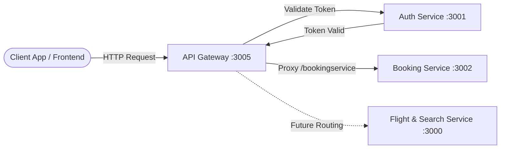

# API Gateway Service

## Overview
The **API Gateway Service** serves as the unified entry point and reverse proxy for the Airline Reservation microservices architecture. It decouples client-facing applications from backend microservices, providing traffic control, reverse proxy routing, centralized rate limiting, request logging, and authentication token verification.

### Key Responsibilities:
- **Reverse Proxy**: Routes incoming API requests to internal downstream microservices (e.g., Booking Service).
- **Authentication Gateway**: Intercepts requests destined for protected routes (like `/bookingservice`) and validates user credentials (`x-access-token`) via the **Auth Service** before proxying.
- **Rate Limiting**: Protects backend services against DoS attacks and traffic spikes using IP-based request throttling (5 requests per 2-minute window by default).
- **HTTP Access Logging**: Logs all incoming network requests using Morgan for monitoring and auditing.

---

## Tech Stack
- **Runtime**: Node.js (v18+)
- **Web Framework**: Express 5
- **Reverse Proxy**: `http-proxy-middleware`
- **Rate Limiter**: `express-rate-limit`
- **HTTP Client**: Axios
- **Logging**: Morgan
- **Process Manager**: PM2

---

## Architecture Flow



---

## Environment Variables

Copy the provided `.env.example` file to create your `.env` file:

```bash
cp .env.example .env
```

| Variable Name | Required | Default Value | Description |
| :--- | :---: | :--- | :--- |
| `PORT` | Optional | `3005` | Port on which the API Gateway listens. |
| `AUTH_SERVICE_URL` | Required | `http://localhost:3001` | Base URL of the Airline Auth Service for token validation. |
| `BOOKING_SERVICE_URL` | Required | `http://localhost:3002` | Target URL of the Airline Booking Service for proxied requests. |
| `FLIGHT_SEARCH_SERVICE_URL` | Optional | `http://localhost:3000` | Target URL of the Flights & Search Service. |
| `RATE_LIMIT_WINDOW_MS` | Optional | `120000` | Rate limiting sliding window in milliseconds (2 minutes). |
| `RATE_LIMIT_MAX_REQUESTS` | Optional | `5` | Maximum allowed requests per window per IP. |

---

## Prerequisites & Installation

### Prerequisites
1. **Node.js**: v18.0.0 or higher
2. **npm**: v9.0.0 or higher
3. Running instances of:
   - **Airline Auth Service** on port `3001`
   - **Airline Booking Service** on port `3002`

### Installation Steps

1. Navigate to the service directory:
   ```bash
   cd API_Gateway
   ```

2. Install dependencies:
   ```bash
   npm install
   ```

3. Create your `.env` configuration file:
   ```bash
   copy .env.example .env    # On Windows
   # cp .env.example .env    # On Linux / macOS
   ```

4. Start the gateway:
   ```bash
   # Development / Standard run
   node index.js

   # Or using PM2 (for production background execution)
   npx pm2 start index.js --name api-gateway
   ```

---

## API Endpoints & Routes

### 1. Health Ping
- **URL**: `/home`
- **Method**: `GET`
- **Access**: Public
- **Response** (`200 OK`):
  ```json
  {
    "message": "OK"
  }
  ```

### 2. Protected Booking Service Reverse Proxy
- **URL**: `/bookingservice/*`
- **Method**: `ALL` (`GET`, `POST`, `PATCH`, `DELETE`)
- **Access**: Protected (Requires valid JWT in `x-access-token` header)
- **Headers**:
  ```http
  x-access-token: <jwt_token_from_auth_service>
  Content-Type: application/json
  ```
- **Forward Target**: `http://localhost:3002/*`
- **Behavior**:
  - The Gateway queries `GET ${AUTH_SERVICE_URL}/api/v1/isauthenticated` passing the `x-access-token`.
  - If token validation fails or header is missing:
    - **Status**: `401 Unauthorized`
    - **Response**:
      ```json
      {
        "message": "Unauthorised"
      }
      ```
  - If token validation succeeds:
    - The request is proxied transparently to `http://localhost:3002/`.
